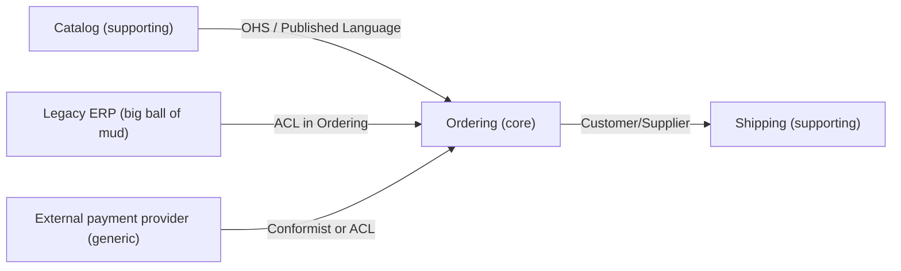

# Strategic Design

Reference for the strategic side of Domain-Driven Design: subdomains, bounded contexts, context mapping, ubiquitous language and Event Storming. Verified against Evans, Domain-Driven Design Reference (2015), Vernon, Implementing Domain-Driven Design (2013) and Brandolini, Introducing EventStorming (2026-10). The patterns are conceptual and not tied to a library version.

## 1. Subdomains

A subdomain is a part of the business problem space. Classify each one, because the classification decides how much modeling effort and which build-or-buy choice it deserves.

| Type | Meaning | Typical approach |
|---|---|---|
| Core | Where the business differentiates and wins; complex and changing | Build in-house with the best people, full tactical DDD, own bounded context |
| Supporting | Needed for the business to run, specific to it, not a differentiator | Build simply (transaction script, active record), may be outsourced |
| Generic | Solved problem, same for everyone (identity, payments, email, search) | Buy or adopt open source; wrap behind a port |

Signals of a core subdomain: the business can describe how it beats competitors there, domain experts disagree about rules, rules change often, and mistakes are costly. Classification is a judgment and changes over time: today's core can become tomorrow's commodity.

The problem space (subdomains) and the solution space (bounded contexts) are different things. Ideally one subdomain maps to one bounded context, but legacy systems often hold several subdomains in one context, and one subdomain can be split across several.

## 2. Finding bounded contexts

A bounded context is the boundary inside which a particular model, and its ubiquitous language, is consistent. Clues to a boundary:

- The same word means different things. "Product" is a catalog entry with images for marketing, a stock-keeping unit with weight and dimensions for the warehouse, and a priced item with taxes for billing. Three contexts, three models.
- Different experts or teams own the vocabulary and disagree about definitions.
- Rules differ for the same data (a "customer" in credit control and a "customer" in a newsletter).
- Different rates of change or different consistency needs.
- Existing organizational boundaries (Conway's law): a context should be owned by one team; one team may own several contexts.
- Different lifecycles: pre-sale quote versus post-sale contract.

Sizing: start with a few coarse contexts and split when language or team boundaries require it. A context is a linguistic and ownership boundary, not automatically a deployable service; a modular monolith can hold several contexts. Service decomposition is covered by microservices-expert.

Name each context and write one paragraph: purpose, key concepts, owner, upstream and downstream relationships, and public API (commands, queries, events).

## 3. Context mapping patterns

A context map shows contexts and the relationship between each pair. For every relationship, state which side is upstream (its decisions affect the other) and which is downstream.

| Pattern | Description | Use when | Cost or risk |
|---|---|---|---|
| Partnership | Two teams succeed or fail together and coordinate releases and changes | Two core contexts with tight mutual dependency | Coordination overhead |
| Shared Kernel | A small, explicitly shared subset of the model and code | Two teams with close collaboration and a small stable overlap | Changes need both teams; tends to grow |
| Customer/Supplier | Upstream (supplier) plans work to meet downstream (customer) needs; negotiated | Upstream team is willing and able to respond | Needs real priority from upstream |
| Conformist | Downstream adopts upstream's model as is | Upstream model is acceptable and upstream will not change for you | Your model is shaped by theirs |
| Anti-Corruption Layer (ACL) | Downstream translates upstream's model into its own at the boundary | Upstream is legacy, external, poorly designed, or unstable | Translation code to maintain |
| Open Host Service (OHS) | Upstream exposes a well-defined protocol for many consumers | Many downstream consumers | Contract must be versioned and supported |
| Published Language | A documented shared language (schema, standard) used for exchange, often with OHS | Integration across organizations or many teams | Governance of the language |
| Separate Ways | No integration; each context solves its needs alone | Integration cost exceeds the benefit | Duplicate functionality |
| Big Ball of Mud | A region without clear model boundaries, marked on the map | Legacy you want to contain | Wrap it with an ACL; do not extend the mud |

Drawing the map:

Keep the map in the repository (text or diagram source), review it when teams or integrations change, and note the integration style for each edge (events, REST, files, shared database to be removed).

## 4. Ubiquitous language

- The language is built with domain experts and used in conversation, documents, tests and code. If the code says `Reservation` and the business says "booking", one of them changes.
- Each context has its own language; a term can exist in two glossaries with different definitions. Write both and the mapping between them.
- A glossary entry: term, definition in one or two sentences, examples and counterexamples, related terms, the code type that represents it.
- Capture verbs as well as nouns: "an invoice is issued, then settled or written off" gives you state transitions and events.
- Use scenarios as language tests: have an expert read an acceptance test aloud; if they stumble, the language is off.
- When a rule is hard to express in the model, the model usually lacks a concept. Ask what the experts call it.

## 5. Event Storming

Event Storming is a collaborative modeling workshop on a long wall (or an online whiteboard) with sticky notes. Participants include developers and domain experts. Use a visible legend; the colors below are a common convention and teams may vary.

| Note | Common color | Content |
|---|---|---|
| Domain event | Orange | Something that happened, past tense: `Invoice Issued` |
| Command | Blue | Intent to change something: `Issue Invoice` |
| Actor | Small yellow | Person or role that issues a command |
| Aggregate | Large pale yellow | Thing that receives the command and emits the event |
| Policy | Lilac | Reaction rule: "whenever X happens then do Y" |
| Read model | Green | Information a person needs to decide |
| External system | Pink | System outside the model that sends or receives |
| Hot spot | Bright (often red or purple) | Question, disagreement, risk |

Formats:

1. **Big picture**: broad, whole business line. Everyone writes domain events on orange notes in chronological order, then resolves duplicates, finds pivotal events, swimlanes and hot spots. Output: shared understanding and candidate context boundaries.
2. **Process level**: pick one flow. Add commands, actors, policies, read models and external systems around the events. Output: the end-to-end process and its decision points.
3. **Design level**: pick one core flow. Identify aggregates that handle commands, the invariants they protect, and the events they emit. Output: candidate aggregates and their boundaries, ready to implement.

Practical tips: events first, no technology talk, let experts correct each other, park disputes as hot spots, photograph or export the wall, and turn it into a timeline plus scenarios (given/when/then) afterwards. Rerun small sessions when a flow changes.

## 6. Evolving and migrating

- Start by naming what exists: document current systems as contexts, including a big ball of mud, and draw the real relationships.
- Protect new models with an ACL. The ACL is a pair: a translator (pure mapping) and an adapter (the technical call).
- Strangler approach: route one capability at a time to the new context, keep the old one running behind the ACL, remove the old path when traffic reaches zero.
- Avoid shared databases between contexts. If one exists today, put a view or API in front, then move ownership of the tables to a single context.
- Team boundaries follow context boundaries where possible; if one team spans two contexts, keep the code boundary explicit anyway.
- Revisit the map after reorganizations; a map that no longer matches the organization is documentation of the past.

## 7. Output artifacts

- Context map with relationship types and ownership.
- Glossary per context.
- Subdomain classification table with build/buy decision.
- Event timeline per core flow, scenarios, and an invariants list that seeds the aggregate design.
- Public API list per context: commands accepted, queries answered, events published (the published language).
